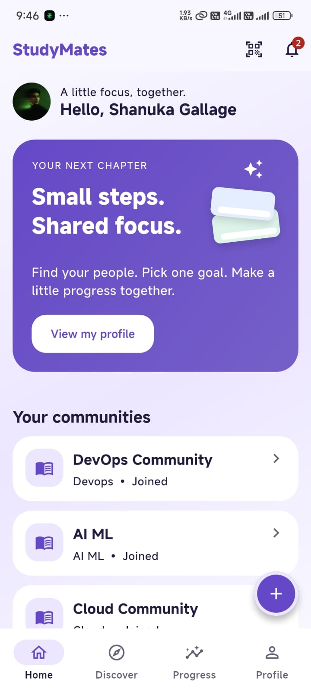
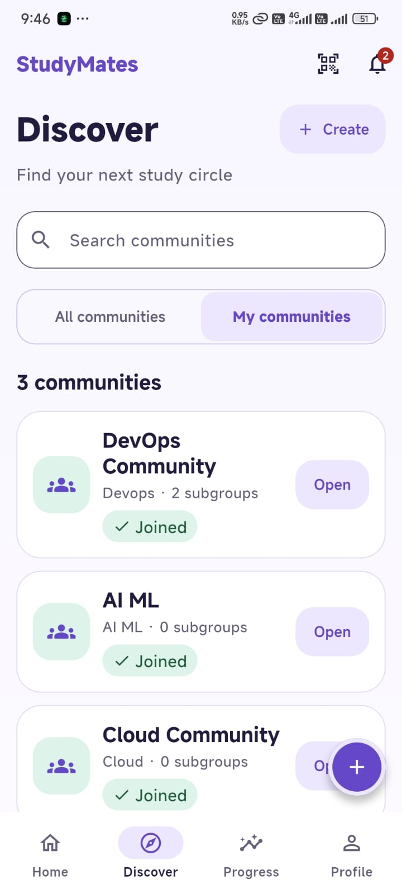
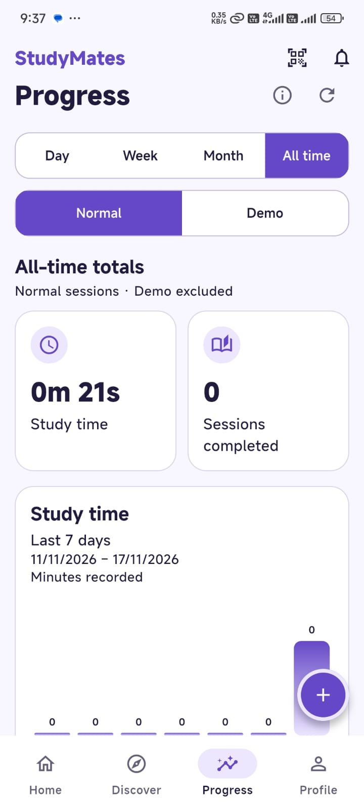
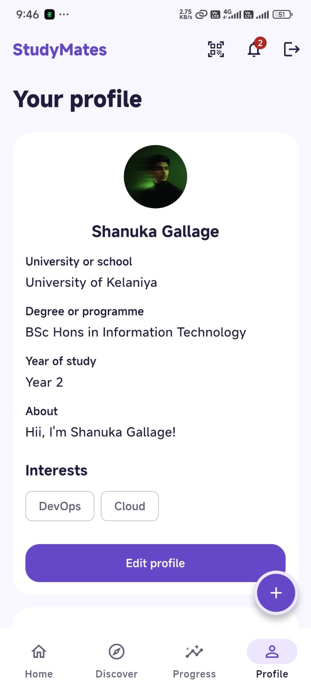
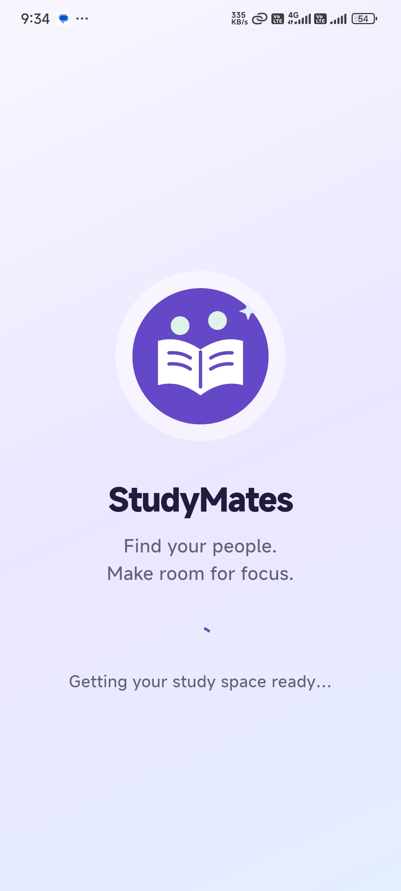
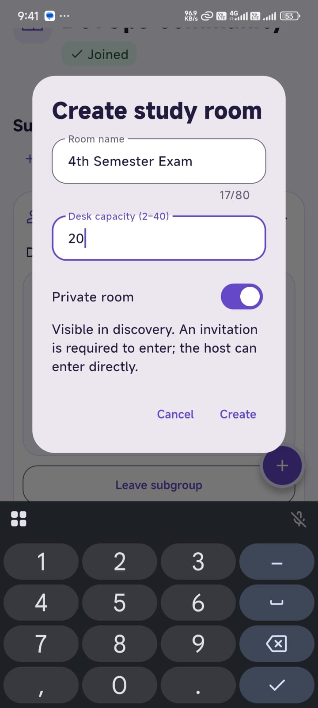
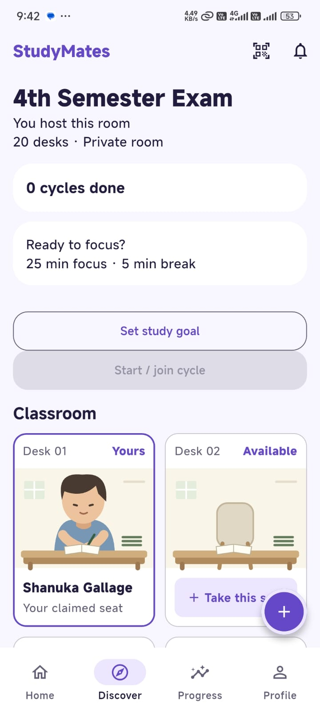
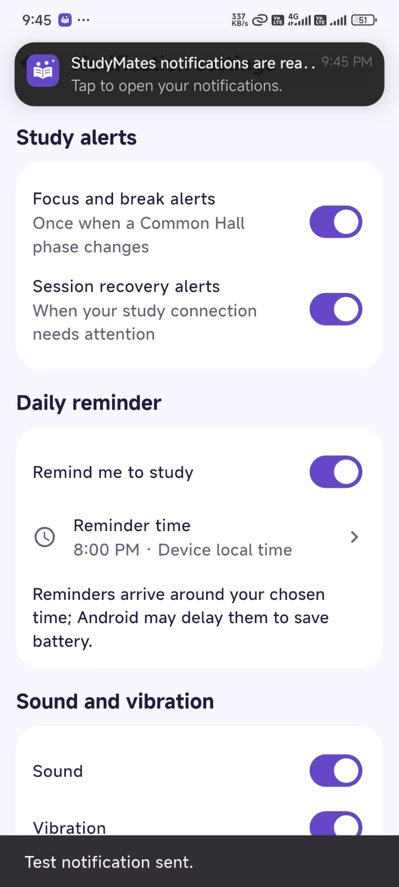

<div align="center">


# StudyMates

**Find your people. Make room for focus.**

An Android study companion built with Flutter and Firebase for students to discover communities, study together, and track their progress.

**University of Kelaniya · Mobile Application Development project**

[Features](#features) · [Screenshots](#screenshots) · [Getting started](#getting-started) · [Demo](#five-minute-demonstration) · [Team](#team)

</div>

## About the project

Studying consistently is easier with a community and a clear goal. StudyMates brings students together around shared interests, gives them a virtual desk in a study room, and helps them turn focused sessions into a personal study history.

The main journey is:

**Discover a community → Join a subgroup → Enter a study room → Set a goal → Study together → Review progress**

Students can also use the **Common Hall** for independent focus sessions alongside other learners. The app has four main tabs: **Home, Discover, Progress, and Profile**.

## Features

| Area | What students can do |
| --- | --- |
| Accounts and profiles | Register and sign in with email/password, reset a password, and manage a profile with a photo, institution, programme, year of study, bio, and interests. |
| Communities | Search communities, filter joined communities, create a community, join or leave communities and subgroups, and browse their study rooms. Community owners manage their subgroups. |
| Live study rooms | Create public or private rooms with **2–40 desks**, see live occupancy, and claim an available desk. Membership checks and atomic seat claims enforce one active room seat per account. |
| Focus sessions | Set a personal goal and join a shared **25-minute focus / 5-minute break** cycle. Return to an active session, save participation, and record the goal outcome separately. |
| Invitations | Generate and share a room QR/manual code, scan or enter a code, review the invitation, and explicitly join. Hosts can manage and revoke invitations. |
| Common Hall | Start a personal 25/5 cycle in a shared hall with one occupied desk per present learner. Android foreground execution supports the timer while the screen is locked. |
| Progress | Review credited focus time, completed sessions, history, charts, and a study calendar. Day/week/month/all-time filters and separate **Normal / Demo** views support review. |
| Notifications | View an on-device alert inbox, control Common Hall focus/break and recovery alerts, and set a daily reminder with sound/vibration preferences. |

Additional room behaviour includes automatic host handover to the longest-seated eligible learner, invitation expiry, seat-release recovery, and a screen-awake option while viewing a study session.

## Screenshots

Android screenshots supplied by the team on **17 November 2026**. Names, communities, and totals are illustrative app data.

<table>
  <tr>
    <th>Home</th>
    <th>Discover</th>
    <th>Progress</th>
    <th>Profile</th>
  </tr>
  <tr>
    <td></td>
    <td></td>
    <td></td>
    <td></td>
  </tr>
</table>

<details>
<summary><strong>More screenshots: launch, room creation, classroom, and notifications</strong></summary>

<table>
  <tr>
    <th>Welcome</th>
    <th>Create a room</th>
    <th>Study classroom</th>
    <th>Notification settings</th>
  </tr>
  <tr>
    <td></td>
    <td></td>
    <td></td>
    <td></td>
  </tr>
</table>

</details>

## Technology and architecture

| Layer | Technology |
| --- | --- |
| Application | Flutter / Dart, Android |
| UI | Material 3 through `material_ui`, shared theme and reusable controls |
| State and navigation | Riverpod, `go_router` |
| Accounts and data | Firebase Authentication, Cloud Firestore, transactions and security rules |
| Invitations | `mobile_scanner`, `qr_flutter`, `share_plus` |
| Android study utilities | `flutter_foreground_task`, `flutter_local_notifications`, `wakelock_plus` |
| Local preferences and time | `shared_preferences`, `timezone`, `flutter_timezone` |
| Verification | Flutter unit/widget tests, Android integration tests, Firebase emulator rule tests |

Presentation consumes providers and repository interfaces; database operations live in the data layer. Connected room, seat, session, and history operations use `FirestoreStudyRepository`. `FirestoreInvitationService` uses the same checked seat-admission path. Explicit preview bindings provide local fixtures for UI development.

```text
lib/
├── main.dart              # Firebase-connected entry point
├── main_preview.dart      # Labelled local UI preview
├── app/                   # Startup, access guards, routes and app shell
├── core/                  # Shared models, theme and controls
├── features/
│   ├── auth/              # Email/password accounts
│   ├── profile/           # Private student profiles
│   ├── communities/       # Communities, subgroups and membership
│   ├── home/              # Home dashboard
│   ├── rooms/             # Room presentation and repository contracts
│   ├── study/             # Connected rooms, seating and invitations
│   ├── sessions/          # Session timing, participation and summaries
│   ├── common_hall/       # Personal cycles and shared hall presence
│   ├── invites/           # QR scanning, manual entry and invitation UI
│   ├── progress/          # Read-only history and progress views
│   └── notifications/     # Local alerts, preferences and inbox
└── preview/               # Fixtures, component gallery and UI scenarios

test/                      # Unit/widget tests and emulator security checks
integration_test/          # Android tests using real Firebase SDKs
functions/                 # Optional administrative cleanup and backend helpers
docs/                      # Demo runbook, contracts, design and team guides
firestore.rules            # Backend access and consistency rules
firestore.indexes.json     # Firestore query/index configuration
```

### Data and session integrity

- App access requires a signed-in Firebase UID and its matching saved profile. Backend errors remain visible; the connected app never substitutes sample data.
- Room admission checks community/subgroup membership and uses transactions for seat ownership. A room seat and a Common Hall session cannot be active at the same time.
- Shared room phases derive from one persisted server start time. Normal cycles use **25/5 minutes**; the explicitly enabled demo cycle uses **45/15 seconds**.
- Each user/session has one immutable completion record. Retrying a save returns the existing result instead of adding duplicate credit.
- Credited time represents eligible focus participation, excluding breaks. It does not measure attention; goal completion is a separate student-reported result.
- Profiles, personal goals, and completion history are private to the account. Shared room/hall presence exposes limited display information.
- Demo records are excluded from normal study totals. Preview sessions do not write connected history.

## Getting started

### Prerequisites

- Project toolchain: **Flutter 3.50.0 / Dart 3.14.0**. Retain the checked-in `pubspec.lock`.
- Android SDK/toolchain, an Android emulator or a phone with USB debugging enabled, and an authorized USB connection when using a phone.
- Internet access for initial dependency downloads and hosted Firebase use.
- For local backend testing: Node.js **22**, Java compatible with the Firebase emulators, and the Firebase CLI commands below.

### 1. Clone and install

```bash
git clone https://github.com/ShanukaGallage/studymates.git
cd studymates
flutter pub get
flutter doctor -v
flutter devices
```

Replace `DEVICE_ID` below with an Android device ID from `flutter devices`.

### 2. Choose a run mode

| Mode | Entry point | Purpose |
| --- | --- | --- |
| Connected app | `lib/main.dart` | Full feature flow using the configured hosted Firebase project. |
| Local backend | `lib/main.dart` with emulator define | Real Firebase SDK operations against local Auth/Firestore emulators. |
| UI preview | `lib/main_preview.dart` | Labelled fixtures without Firebase; useful for inspecting screens and states. |

**Connected app**

```bash
flutter run -d DEVICE_ID -t lib/main.dart
```

The repository includes Android client configuration for the team's `studymates-dev` project in `android/app/google-services.json` and `lib/firebase_options.dart`. Hosted use requires Email/Password Authentication, a Firestore database, and the matching deployed rules/indexes. Register an account and complete profile setup before using the app; use two accounts/devices to evaluate live collaboration.

Firebase project maintainers can deploy the checked-in Firestore configuration:

```bash
npm exec --yes --package firebase-tools -- firebase login
npm exec --yes --package firebase-tools -- firebase deploy \
  --project studymates-dev --only firestore:rules,firestore:indexes
```

Evaluators do not need deployment permissions to use an already configured backend. The connected client supports the Spark plan through Firestore transactions and membership self-cleanup; Cloud Functions are optional. Firebase client configuration is distinct from administrator credentials. Do not add service-account keys, account passwords, or signing secrets to the repository.

**Local backend — reproducible connected evaluation**

Start Auth and Firestore emulators in one terminal and leave them running:

```bash
npm exec --yes --package firebase-tools -- firebase emulators:start \
  --only auth,firestore --project studymates-dev --config firebase.emulators.json
```

In another terminal, forward the ports to the selected Android device and launch:

```bash
adb -s DEVICE_ID reverse tcp:8080 tcp:8080
adb -s DEVICE_ID reverse tcp:9099 tcp:9099
flutter run -d DEVICE_ID -t lib/main.dart \
  --dart-define=STUDYMATES_EMULATOR_HOST=127.0.0.1
```

Repeat the forwarding and launch steps for a second device to share the same local backend. Create fresh test accounts: emulator accounts/data are separate from hosted Firebase and are temporary unless exported. This mode is visibly labelled in the app.

**UI preview — no backend required**

```bash
flutter run -d DEVICE_ID -t lib/main_preview.dart
```

Explore the tabs, component gallery, and sample/loading/empty/error scenarios. Preview membership and seat selection are local UI interactions; selecting a desk does not reserve a server seat. Local fixtures reset when restarted.

### 3. Build an Android APK

```bash
flutter build apk --debug -t lib/main.dart
```

Output: `build/app/outputs/flutter-apk/app-debug.apk`.

For an ARM64-only demo device, add `--target-platform android-arm64`. To build the independent preview, change the target to `lib/main_preview.dart`. These commands produce debug APKs for evaluation.

## Five-minute demonstration

Prepare two signed-in accounts on two Android devices using the same backend. Create the community/subgroup beforehand and have both accounts join to keep the live demonstration within five minutes.

| Time | Demonstration |
| --- | --- |
| 0:00–0:30 | Introduce StudyMates; show Home and the two student profiles. |
| 0:30–1:15 | Open Discover, the shared community, and its subgroup; create or open a study room. |
| 1:15–2:00 | Share/scan a fresh invitation or enter its code; show both learners in different desks. |
| 2:00–2:20 | Set personal goals; the host explicitly enables the **60-second demo cycle**, starts it, and the guest joins. |
| 2:20–3:20 | Observe the shared 45-second focus and 15-second break countdown. |
| 3:20–4:10 | Save each participation, choose the goal outcome, and open **Progress → Demo**. |
| 4:10–4:40 | Reopen history to show persistence and show that Normal totals exclude demo sessions. |
| 4:40–5:00 | Explain one reliability behaviour, such as occupied-seat protection, and finish. |

Use a newly generated invitation during evaluation. End/save participation and release existing seats before repeating the flow or entering Common Hall. Detailed setup, recovery steps, and device checks are in the [demo runbook](docs/demo-runbook.md).

## Testing

Run the independent Flutter checks from the repository root:

```bash
dart format --output=none --set-exit-if-changed lib test integration_test
flutter analyze
flutter test
```

With the local Auth/Firestore emulators running, exercise backend rules:

```bash
node test/firestore_membership_rules_test.mjs
node test/firestore_study_rules_test.mjs
node test/room_host_invitation_rules_test.mjs
node test/common_hall_rules_test.mjs
```

After configuring ADB port forwarding, run connected Android integration checks against the emulators:

```bash
flutter test integration_test/connected_study_test.dart -d DEVICE_ID \
  --dart-define=STUDYMATES_EMULATOR_HOST=127.0.0.1
```

Additional Android suites cover host handover, profile photos, Common Hall, notifications, and session utilities. Some require manual lock/unlock steps described in the runbook. Backend helper tests can be run with `npm --prefix functions ci` followed by `npm --prefix functions test`.

Tests cover account/profile access, navigation, membership, seat conflicts and leases, session timing, completion deduplication, invitation validation, private history, demo separation, and responsive/accessibility states. Screenshots illustrate the UI; they are not evidence that every runtime scenario has passed. See the [runbook's verification checkpoints](docs/demo-runbook.md) for recorded device results and outstanding checks.

## Current limitations

- **Android is the evaluation target.** Other platform folders do not imply verified support; Firebase platform configuration is Android-specific.
- **Connected features need a reachable backend.** Room seats renew while the app is foregrounded and expire after approximately two minutes without renewal. Returning after expiry requires explicit recovery; the app never silently reclaims a seat.
- **Common Hall depends on Android service execution.** Force stop, reboot, connectivity loss, or battery restrictions can interrupt it. After a three-minute confirmation gap, recovery credits only confirmed focus time. The full notification lock/restart/recovery walkthrough remains pending in the runbook.
- **Notifications are local to the device/account.** Daily reminders are approximate and subject to Android settings. There is no FCM, email, or room/community push-notification service.
- **History is sized for the university project.** Summary reads use the user's completion collection; calendar/history views identify partial loaded data. Larger deployments would need aggregate read models.
- **Invitations require in-app scanning or manual entry.** Android deep-link handling is not configured. Revoking a code prevents new admissions but does not remove users already admitted.

## Team

| Member | Coordinating responsibility |
| --- | --- |
| **Shanuka IM/2023/001** | Shared UI/theme, navigation, room/session presentation, integration, and release coordination; also covering connected study implementation for the demo. |
| **Poojani IM/2023/087** | Firebase setup, authentication, profiles, communities, and membership. |
| **Aradhana IM/2023/088** | Timing, completion logic, and invitation services. |
| **Sajana IM/2023/096** | Live-room/session contracts, seating. |
| **Sandali IM/2023/103** | Invitation UI, QR/manual scanning, and read-only history/progress. |

The [four-member common plan](docs/team/00-common-plan.md) records ownership and collaboration boundaries.

## Project documentation

- [Demo runbook](docs/demo-runbook.md) — connected setup, five-minute walkthrough, recovery, and verification checkpoints.
- [Contracts](docs/contracts.md) — shared models, repository boundaries, backend behaviour, and implementation history.
- [Design system](docs/design/design-system.md) — theme and reusable UI guidance.
- [Screen guide](docs/design/screens.md) — screen and navigation design.
- [Team plan](docs/team/00-common-plan.md) — responsibilities and integration workflow.

Some planning documents retain earlier milestone assumptions. This README describes the current application; dated implementation updates in the contracts and runbook provide the detailed context.
